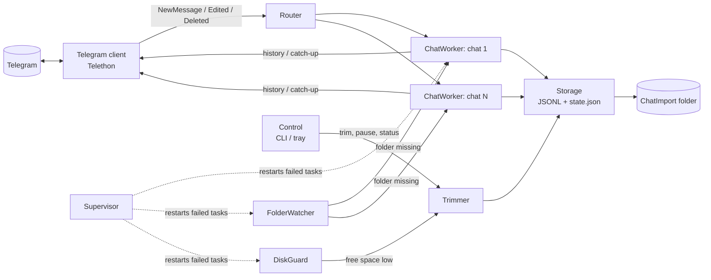
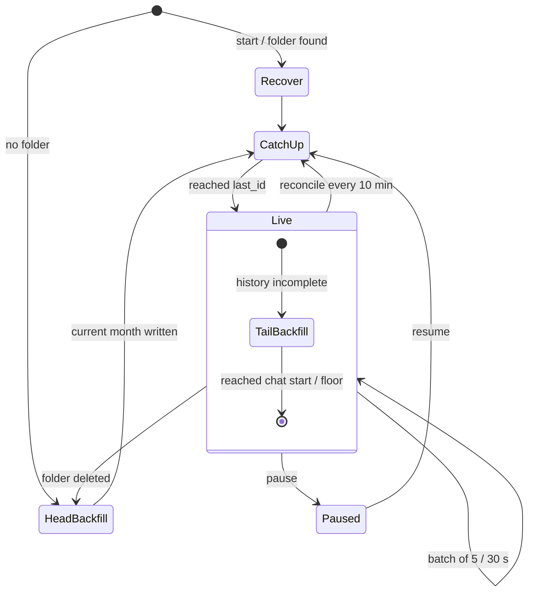

# ChatImport — Architecture

English version of the owner's spec v1.2 (2026-10-29; the Russian original is kept outside
the repository), updated 2026-10-31 to the implemented code (stages 0.1–0.7 and the
hardening pass of 2026-10-30). This file is the reference inside the repository; where code
and this file disagree, the code is the fact and this file is fixed in the same task.

## 1. Goals and non-goals

ChatImport keeps the full text history of about eight Telegram groups and channels locally,
in a machine-readable form. It reacts to new messages almost at once but writes in batches;
it is controlled by simple actions (delete a folder to refetch it, `trim` to drop old
history); it guards free disk space; and its record format already has room for media.

It does **not**: read Telegram Desktop's encrypted `tdata` (it is its own client; Telegram
Desktop may be closed); analyse messages (that is ChatRadar's job); fetch secret chats
(unavailable through the API); send or publish anything anywhere.

## 2. Requirements

| ID | Requirement |
|---|---|
| F1 | First run for a chat fetches its whole available text history. |
| F2 | Then new messages are written in batches of N (default 5) or every T seconds (default 30), whichever comes first. |
| F3 | Format: JSONL, one JSON object per line. |
| F4 | Output folder `ChatImport` on the current user's Desktop by default; the path changes without code edits (command, tray, environment variable, config), moving existing data (§7.3). |
| F5 | A deleted chat folder means a full refetch of that chat; a deleted root means all chats. |
| F6 | Disk guard: when the volume has less than 15 GB free, delete the oldest messages until at least 17 GB is free; recent messages stay. |
| F7 | Manual trim of the oldest 25 / 50 / 75 % — strictly in order, for all chats or one. |
| F8 | Edits and deletions are separate records; history is never rewritten. |
| F9 | Every record has a `media` field; enabling media is a setting, not a redesign. |
| F10 | **Only** groups and channels from the `chats.toml` library are tracked; private dialogs and everything else are ignored. The library changes without a restart (§7.2). |
| F11 | Sender names (`sender_name`, `sender_username`) are stored, not only `sender_id`. |
| F12 | Daily recheck of the last N days (default 7) records edits and deletions missed while the service was off (§8.7). |

| ID | Non-functional |
|---|---|
| N1 | Python ≥ 3.14. |
| N2 | Free open-source dependencies only. |
| N3 | No duplicates and no losses across restart, crash or power loss (at-least-once intake + dedup by `msg_id`). |
| N4 | Files are not held open between writes, so Windows can delete a folder. |
| N5 | Gentle on Telegram limits: pauses, FloodWait handling, no aggressive parallelism. |
| N6 | One failing subtask never brings the service down; status is visible in `_status.json` and the tray. |
| N7 | One service instance per user. |

## 3. Stack

| Need | Component | License |
|---|---|---|
| Language | Python 3.14 | PSF |
| Project manager | uv | MIT / Apache-2.0 |
| Telegram (MTProto) | Telethon 1.x | MIT |
| Faster crypto (optional) | cryptg, only if a 3.14 wheel exists | CC0 |
| Desktop and app folders | platformdirs (`user_desktop_dir`, `user_data_dir`) | MIT |
| Single instance | filelock | Unlicense |
| CLI | Typer (with Click and Rich) | MIT / BSD-3 |
| Tray (optional) | pystray + Pillow | LGPL-3.0 / MIT-CMU |
| Confirmation dialogs | tkinter | PSF (stdlib) |
| Config | `tomllib` (read-only) | stdlib |
| Free space | `shutil.disk_usage` | stdlib |
| Logs | `logging` + `RotatingFileHandler` | stdlib |
| Development | pytest, pytest-asyncio, ruff, pyright | MIT |

Deliberately **not** used: a database (the files are the storage), watchdog/inotify (polling
every 10 s is more reliable across systems and Explorer deletions), Docker (the service needs
the user's Desktop and tray).

## 4. Components



| Component | Does | Does not |
|---|---|---|
| TelegramClient | connection, session, `iter_messages`, events, FloodWait | write files |
| Mapper | pure `Telethon Message → dict` (§6) | any I/O |
| Library | reads `chats.toml`, resolves refs to `chat_id`, watches the file | fetch messages |
| Router | routes events to workers by `chat_id`; drops anything outside the library | write files |
| Rechecker | daily comparison of the last N days with Telegram | write directly — hands records to the worker |
| ChatWorker (one per chat) | state machine: backfill, catch-up, live buffer, writes | touch other chats |
| Storage | layout, atomic writes, `state.json`, recovery | know about Telegram |
| Trimmer | deletes old messages in order (manual and automatic) | decide *when* |
| DiskGuard | checks free space every 5 min, calls the trimmer | |
| FolderWatcher | checks folders every 10 s, notifies workers | |
| Control | commands from CLI/tray, `_status.json` | |
| Supervisor | starts tasks, restarts failed ones with exponential backoff | |

**One writer.** Only the service process writes into `ChatImport`, and inside it only the
chat's worker (or the trimmer holding that chat's `asyncio.Lock`). CLI and tray send
commands (§9.3), which the service runs at most once. Without a running service the CLI
takes the single-instance lock and is that one writer. No inter-process locking of data
files is needed. Exception: `export-json` reads the parts directly and writes only its own
file under `_exports/`, with or without the service.

### Worker state machine



- **HeadBackfill** — the current month (newest messages).
- **CatchUp** — `iter_messages(min_id=last_id)`: everything since the service last listened.
- **Live** — events into a buffer, written in batches.
- **TailBackfill** — older months in the background, in parallel with Live (other files).
- **Paused** is stored as `phase = "paused"`, so a restart stays paused until `resume`.
- **NoAccess** (removed from the chat, chat gone): data kept, access retried after 60 s,
  doubling up to 1 h.

## 5. Storage on disk

### 5.1 Locations (Windows; `platformdirs` gives the equivalents elsewhere)

| What | Where | Why |
|---|---|---|
| Chat data | `%USERPROFILE%\Desktop\ChatImport\` | default; changeable (§7.3) |
| Config | `%LOCALAPPDATA%\ChatImport\config.toml` | deleting data must not delete settings |
| Library | `%LOCALAPPDATA%\ChatImport\chats.toml` | a separate hand-edited file |
| Session | `%LOCALAPPDATA%\ChatImport\session\chatimport.session` | a secret; survives data deletion |
| Logs | `%LOCALAPPDATA%\ChatImport\logs\` | |
| Instance lock | `%LOCALAPPDATA%\ChatImport\chatimport.lock` | |
| Command queue | `%LOCALAPPDATA%\ChatImport\control\` | |

### 5.2 Layout

```
ChatImport/
├── _status.json               # service status, refreshed every minute (read-only)
├── _trim_log.jsonl            # every deletion: when, what, why
├── _unrouted_deletes.jsonl    # deletions without a chat_id (§6.2), capped at 2 MiB
├── _exports/                  # export-json output (§9.1)
└── <slug>_<chat_id>/          # for example example_group_-1001234567890
    ├── state.json             # chat state (§6.3)
    ├── 2024-03_001.jsonl      # <UTC month>_<part>; lines ascend by msg_id
    ├── 2026-09_001.jsonl
    ├── 2026-09_002.jsonl      # the month did not fit into one part
    ├── 2026-10_001.jsonl      # current part of the current month — live appends here
    └── media/2026-10/4512.ogg # saved media (§12), only with media.enabled
```

- A chat is identified by `chat_id` in `state.json`, never by its folder name: renaming the
  chat in Telegram or the folder by hand changes nothing.
- Names starting with `_` are service files, not chats.
- The folder name is `<slug>_<chat_id>`. The slug comes from the library `name` or the chat
  title, transliterated to ASCII (Cyrillic to Latin, accents dropped, `textnorm.transliterate`),
  lower case, at most 40 characters; `chat` when nothing is left.
- **Month files are split into parts.** The part is the unit of storage, deletion and
  accounting in `state.json`.

| Rule | Description |
|---|---|
| Name | `YYYY-MM_NNN.jsonl`: UTC month (`01`–`12`) and zero-padded part number (`001`–`999`); name order is chronological. Anything else is not a part, and a `state.json` chunk key that is not a part name is dropped, so no trim can reach outside the folder |
| Threshold | `max_chunk_mb = 20`. Before appending a batch: if the current part is ≥ 20 MB, open the next. A batch is never split, so a part may slightly exceed the threshold |
| Order | Part `_001` holds a month's oldest messages; inside a part, ascending `msg_id` |
| Backfill | A month is collected in memory, sorted and written into parts by threshold. When the month already has parts (a refetch, a late message), the new records are merged into them in `msg_id` order and unreadable lines are kept byte for byte |
| Month rewrite | A month of several parts is replaced as one crash-safe step (`storage/month_commit.py`): new parts are staged as `.<part>.new`, a journal `.<month>.commit.json` is written atomically, then the staged files replace the parts and surplus parts are deleted. Recover finishes a journalled commit and drops staged files without a journal |
| Edits and deletions | Appended to the last part of the event's month |
| Threshold change | Applies to new parts only; old parts are not re-split |
| Accounting | Each part is an entry in `state.json → chunks` (records, first and last `msg_id`, bytes) |
| Trimming | Auto-trim deletes the oldest whole part; manual trim deletes whole parts and cuts one boundary part (§8.5, §8.6) |

### 5.3 Expected volume

One record with sender names is about 0.4–0.6 KB. Earlier profiling of the owner's chats
(8 chats, ~177 thousand messages over 2022–2026): ~450 messages per chat per month,
~0.2–0.3 MB per month file, ~100 MB for the whole text archive (~400 MB with `include_raw`).
Text alone will not fill a disk; the 15 GB guard matters once media is on (§12). Parts keep
manual trims fast, auto-trim fine-grained and files easy to open; most months will be a
single `_001`.

### 5.4 Why JSONL

Appending 5 messages adds 5 lines instead of rewriting a file; old history is deleted as
whole files; a crash damages at most the last line, which recovery cuts; reading is a
streaming `for line in f: json.loads(line)`. Lines are compact UTF-8 JSON with non-ASCII text
kept readable, but U+2028, U+2029 and U+0085 (line breaks to `str.splitlines`) and lone
surrogates are written as escapes, so every reader sees one record per physical line.
`chatimport export-json --chat X` assembles a classic JSON array when needed.

## 6. Data format

### 6.1 Message record (`kind = "message"`)

```json
{
  "v": 1,
  "kind": "message",
  "source": "telegram",
  "chat_id": -1001234567890,
  "msg_id": 4512,
  "date": "2026-10-29T21:03:11Z",
  "edit_date": null,
  "fetched_at": "2026-10-29T21:03:40Z",
  "sender_id": 777000111,
  "sender_name": "Example Person",
  "sender_username": "example_user",
  "text": "Where can I get an apostille in Montevideo?",
  "reply_to_msg_id": 4507,
  "topic_id": null,
  "grouped_id": null,
  "forwarded": false,
  "service": null,
  "link": "https://t.me/c/1234567890/4512",
  "media": null
}
```

| Field | Type | Meaning |
|---|---|---|
| `v` | int | Schema version. New fields keep it; removal or a change of meaning bumps it |
| `kind` | str | `message` · `edit` · `delete` |
| `chat_id`, `msg_id` | int | Message key; `msg_id` is unique within a chat |
| `date`, `edit_date`, `fetched_at` | ISO 8601 UTC | Always UTC with a `Z` suffix |
| `sender_id` | int \| null | `null` for anonymous admins and channels |
| `sender_name` | str \| null | Display name at fetch time (first + last name, or channel title); on by default (`include_sender_names`) |
| `sender_username` | str \| null | The sender's @username, if any |
| `text` | str | As is; empty string for media-only messages |
| `reply_to_msg_id`, `topic_id` | int \| null | Reply and forum topic (in forums `reply_to` may point at the topic) |
| `grouped_id` | int \| null | Album |
| `forwarded` | bool | Forwarded message |
| `service` | str \| null | Service event type (`join`, `leave`, `pin`, …) |
| `link` | str \| null | `t.me/<username>/<id>` or `t.me/c/<id without -100>/<id>` |
| `media` | object \| null | Attachment description (§12); `file = null` while media is off |

`include_raw = true` adds `raw` with the full `message.to_dict()` (dates as ISO, bytes as
base64) — compatible with ChatRadar's raw payload. Off by default: 3–5× the volume. With
`include_sender_names = false` the keys that name a person (`from_name`, `post_author`,
`first_name`, `last_name`, `phone_number`, `vcard`, `username`) are dropped from `raw` too.

### 6.2 Edit and delete

```json
{"v":1,"kind":"edit","chat_id":-1001234567890,"msg_id":4512,"edit_date":"2026-10-29T21:10:02Z","text":"new text","media":null,"detected_by":"event","fetched_at":"2026-10-29T21:10:05Z"}
{"v":1,"kind":"delete","chat_id":-1001234567890,"msg_ids":[4510,4511],"detected_by":"event","fetched_at":"2026-10-29T21:11:00Z"}
```

- `detected_by`: `event` (real time) or `recheck` (§8.7).
- Written into the file of the **event's** month; history stays append-only.
- Consumers apply them on top: the latest `edit` wins; `delete` is a mark. An edit of a
  message whose month was trimmed is ignored.
- For **basic small groups** Telegram sends deletions without a `chat_id`; their ids (nothing
  else) go to `ChatImport/_unrouted_deletes.jsonl`, written in a worker thread. Past 2 MiB
  only the newest 1 MiB is kept. Supergroups and channels always carry the `chat_id`.

### 6.3 `state.json`

```json
{
  "v": 1,
  "chat_id": -1001234567890,
  "title": "Example group",
  "username": "example_group",
  "phase": "live",
  "last_id": 4512,
  "floor_id": 118,
  "floor_reason": "manual_trim_25",
  "last_recheck_at": "2026-10-29T07:00:00Z",
  "backfill": {"done": false, "head_id": 4380, "oldest_done_id": 2201, "started_at": "2026-10-29T20:00:00Z"},
  "chunks": {
    "2026-09_001": {"records": 1830, "first_id": 2201, "last_id": 3999, "bytes": 912345},
    "2026-10_001": {"records": 520, "first_id": 4000, "last_id": 4512, "bytes": 260111}
  },
  "updated_at": "2026-10-29T21:03:40Z"
}
```

- `last_id` — the highest written `msg_id`; anything `≤ last_id` is never written again.
- `floor_id` — the history floor: the service never fetches older messages by itself.
  Trims and a disk-space stop raise it; only `backfill --deeper` or deleting the chat
  folder lowers it.
- `phase` is one of `recover`, `head_backfill`, `catch_up`, `live`, `paused`, `no_access`;
  `floor_reason` is `manual_trim_<pct>`, `manual_delete` (parts deleted by hand), `disk`
  (auto-trim and the disk-space stop of a backfill) or `null`.
- **`state.json` is a cache.** The JSONL files are the truth; a missing or broken state is
  rebuilt by scanning them (§10.2). A state that exists but cannot be read right now (a
  sharing violation, a permission error) raises `StateUnreadable`: the chat is skipped and
  retried, never rebuilt over. Writes are atomic (temp file → `fsync` → `os.replace`).

## 7. Configuration

### 7.1 `config.toml`

Template with every default: `config.example.toml` in the repository root. Sections:
`telegram` (API id and hash, `flood_sleep_threshold`), `output` (`root_dir`,
`include_sender_names`, `include_raw`, `max_chunk_mb`), `library` (`file`,
`reload_check_seconds`), `recheck` (`enabled`, `days`, `daily_at`, pause), `live`
(`flush_every_messages`, `flush_every_seconds`, `reconcile_every_minutes`), `backfill`
(`batch_size`, pauses, `max_parallel_chats = 1`, `use_takeout`), `disk` (watermarks 15/17 GB,
`check_every_minutes`, `protect_recent_days = 30`), `watch` (`check_every_seconds`,
`confirm_checks = 2`), `media`, `events`. An empty file gives all defaults. Changes apply
on restart (or "Reload config" in the tray), except the library and the output path, which
change live. `backfill.use_takeout` is accepted but not used yet (`docs/backlog.md`).

### 7.2 Library `chats.toml`

The only source of truth for what is tracked. Template: `chats.example.toml`. Each
`[[chat]]` has `ref`, optional `name` (folder name) and optional `enabled`.

| `ref` kind | Resolved by | Notes |
|---|---|---|
| `https://t.me/name`, `@name` | `get_entity` | public groups and channels |
| `https://t.me/+…`, `t.me/joinchat/…` | invite check | **never joins by itself**: not a member → status "need to join" |
| `-100…` | among your dialogs | the most reliable |
| text | exact title among your dialogs (compared after Unicode NFC) | two equal titles → "ambiguous, use a link"; a rename breaks it |

- After the first resolution the `chat_id` is kept in `state.json`; later renames do not
  matter.
- A ref that points at a person or a bot gets "not a group or channel" and is ignored.
- The file is checked every 10 s by mtime: a new entry starts a backfill; `enabled = false`
  or removal stops collection and keeps the folder.
- A syntax error keeps the previous valid version running and shows the error in the tray
  and `_status.json`.
- Each entry's resolution (found / need to join / not found / ambiguous) shows in
  `chatimport chats list` and `_status.json`. Invite links are secrets: outside `chats.toml`
  they are shown masked (the first characters plus a short digest).
- All refs go through one parser (`refs.py`): `t.me`, `telegram.me`, query strings and
  `@name` forms of one chat are the same entry. Names, titles and selectors typed by a person
  are compared through `textnorm.fold` (NFC, casefold, collapsed spaces).

### 7.3 Output path

First match wins: `--root <path>` → `CHATIMPORT_ROOT` → `output.root_dir` →
`<Desktop>\ChatImport`. `~` and environment variables expand; if the path does not end in
`ChatImport`, the folder is created inside it.

`chatimport set-root <path> [--move] [--yes]` (or tray "Change folder…"): validate the path
(creatable, writable; not the current folder, not inside it and not around it; apart from the
application folder, which holds the session; without `--move` an existing non-empty folder
must already hold ChatImport data; warn about OneDrive) → stop the runtime of the old root,
flushing every worker → with `--move` move the data (rename on the same volume; across
volumes a copy that keeps links as links and refuses directory junctions, compared by file
count and size, then the old folder is deleted; without `--move`, a full refetch after a
confirmation) → save the path to `config.toml` (comments kept) → start a runtime on the new
root, whose DiskGuard watches the new volume. A failed move restarts on the old root. When
`CHATIMPORT_ROOT` is set, the answer warns that it overrides the saved folder.

`run`, `status` and the tray warn when the data root is synced to OneDrive.

## 8. Scenarios

### 8.1 Start

1. Take the single-instance lock; if taken, say "already running" and exit.
2. Read the config, set up logging (`run`: console and file; `tray`: file) and connect (the
   session exists after `chatimport login`).
3. Read the library and resolve refs; unresolved ones go to the log, status and a
   notification.
4. Subscribe to events **before** starting workers (events queue up; nothing is lost).
5. Per chat: folder found by `state.json` → Recover → CatchUp → Live; no folder →
   HeadBackfill. A chat stored as `paused` stays paused.
6. Start FolderWatcher, DiskGuard, the recheck scheduler, the `_status.json` refresh, the
   media downloader and its disk gate (when media is on) and Control.

Everything that belongs to one data root (workers, registry, router, trimmer, guards, status,
`BackfillSlots`) lives in one `ServiceRuntime`; a root change stops it and starts a new one.

### 8.2 Full backfill (newest to oldest)

So that any stop leaves the most recent history already on disk:

1. **HeadBackfill.** `head_id` = newest message; fetch the current month, sort, write
   atomically; `last_id = head_id`; go to CatchUp → Live within minutes.
2. **TailBackfill** (background): `iter_messages(offset_id=oldest_done_id)` walks back; when
   a message of the previous month appears, the collected month is sorted and written in
   parts (merged when parts of that month exist); `oldest_done_id` and `chunks` update.
3. Chat start or `floor_id` reached → `backfill.done = true`.
4. Interrupted → resume from `oldest_done_id`; an unfinished month is refetched
   (idempotent).
5. Free space below `low_watermark` → the disk guard stops every unfinished backfill and
   persists it: `floor_id = oldest_done_id`, `floor_reason = "disk"`, `backfill.done = true`,
   one notification. No automatic resume (it would fetch and delete forever);
   `chatimport backfill --deeper` continues it.

**One chat at a time.** Head and tail backfill both hold a slot of the runtime's
`BackfillSlots` (`backfill.max_parallel_chats`, default 1) while they talk to Telegram;
waiting chats get a slot in arrival order, and a paused chat gives its slot back. A tail that
fails for any reason other than lost access, a revoked session or an unreadable state
retries alone after 60 s, doubling up to 1 h, while live collection goes on; the status
shows the failure. A FloodWait above the threshold sleeps only that worker while the other
chats stay live. Heavy file work (a month write, a recover) runs in a thread under the
chat's lock and is never abandoned by a cancellation.

### 8.3 Live

1. `NewMessage` → Router → the chat's worker queue.
2. The worker buffers; flush at `flush_every_messages` records **or** `flush_every_seconds`
   after the first buffered record, whichever comes first.
3. Flush: drop `msg_id ≤ last_id` → sort by `msg_id` → open the current part for append (or
   the next if ≥ `max_chunk_mb`) → write → `flush` + `fsync` → **close** → update
   `state.json` (`last_id`, `chunks`).
4. A batch crossing a month boundary is split into its months' files.
5. `MessageEdited` / `MessageDeleted` go through the same buffer as `edit` / `delete`.
6. A message with `msg_id ≤ last_id` that is not yet stored (Telegram fills update gaps out
   of order) is merged into its month in `msg_id` order instead of being dropped.
7. Every `reconcile_every_minutes` a safety CatchUp picks up what events missed
   (disconnects, sleep, known update gaps).
8. The event queue and the buffer hold at most 20,000 events. Beyond that (a long write
   outage, a paused or backfilling chat) events are counted, not kept; the worker then
   catches up from Telegram and asks for a recheck, so nothing is lost silently.
9. On shutdown (Ctrl+C, tray exit) the buffer is flushed.

### 8.4 Folder deletion

| Deleted | Reaction |
|---|---|
| A chat folder | after 2 checks in a row (~20 s): HeadBackfill from scratch, `floor_id` reset |
| The whole `ChatImport` | recreate; HeadBackfill for every chat, one at a time |
| Only `state.json` | rebuild from files, **no** refetch |
| Some part files | treated as a manual trim: `floor_id` rises to the first remaining message |
| The current month's file | likewise; new messages go into a new file |

Two checks are needed because Explorer deletes a large folder gradually. The same
confirmation applies to a mismatch between `state.json` and the parts; a `state.json` that
cannot be read right now is left alone. Files are closed between writes, so Windows does not
block the deletion.

### 8.5 Automatic disk guard

```
every 5 minutes:
  free = disk_usage(root_dir).free
  if free < 15 GB:
      stop every unfinished backfill for good (§8.2 step 5)
      while free < 17 GB:
          candidate = the oldest part across ALL chats that is entirely older than protect_recent_days
          if none: notify "space is low, but everything allowed is already deleted" -> stop
          os.remove(candidate)            # not the Recycle Bin, or no space is freed
          raise that chat's floor_id, update chunks, append to _trim_log.jsonl
          free = disk_usage(root_dir).free
      notify "freed X GB: deleted parts ..."
```

Oldest first across all chats; the 15/17 GB gap prevents trimming on every message;
`protect_recent_days` keeps recent history even when something else filled the disk. With
media on, a separate `MediaDiskGate` pauses downloads below 15 GB and resumes them at 17 GB.

### 8.6 Manual trim 25 / 50 / 75 %

`chatimport trim 50` (all chats) or `chatimport trim 50 --chat example_group`:

1. Per chat: `total = sum(chunks[*].records)`, `target = floor(total × p)`.
2. Delete parts from the oldest while their records sum to ≤ `target`.
3. The remainder in the boundary part: read it, skip the first `k` lines, write the rest to
   a temp file → `os.replace`.
4. `floor_id` = first remaining `msg_id`; update `chunks`; append to `_trim_log.jsonl`.
5. Percentages are **per chat** — half of each chat's history, not half of the bytes.

Allowed values: 25, 50, 75 (100 % = delete the folder). The tray asks for confirmation; the
CLI asks `y/N` (`--yes` for scripts).

The trimmer works only inside the chat folder, under the chat's lock; folders of disabled
library entries are trimmed too, under a lock of their own; an unknown `--chat` is an error.
The kept lines of the boundary part are copied byte for byte. Media of the removed messages
are deleted with them (by `msg_id`). After a partial failure `state.json` and
`_trim_log.jsonl` still describe what is on disk.

### 8.7 Daily recheck of the last 7 days

Edit and delete events arrive only while connected; the recheck catches what changed while
the laptop was off.

**When:** daily at `recheck.daily_at` (local time; the wait is recomputed with the zone
offset of the target day, so a DST change does not shift it) and on start if
`last_recheck_at` is over 24 h old. One chat at a time with pauses; a chat in backfill is
postponed. `chatimport recheck [--chat X] [--days N]` asks for one now.

**How (one chat):**

1. Window: now minus 7 days up to `last_id`, never below `floor_id`.
2. Read the window's current state from the files (latest version of each `msg_id` after
   existing `edit`/`delete` records). Only parts from the month of the window start on are
   decoded, in a worker thread.
3. Fetch the window from Telegram: `iter_messages(offset_date=…, reverse=True)` up to
   `last_id`.
4. Compare: newer `edit_date` or different text/media → `edit` with `detected_by:
   "recheck"`; in the file but not returned → `delete` with `detected_by: "recheck"`; returned
   but not in the file → append as a normal `message` (consumers sort by `msg_id`).
5. Update `last_recheck_at`.

This also places small-group deletions that arrived without a `chat_id`. Load: a few
thousand messages and tens of requests a day.

### 8.8 Library changes at run time

| Change in `chats.toml` | Reaction |
|---|---|
| Entry added | resolve → create folder → HeadBackfill (in the shared backfill queue) |
| `enabled = false` / entry removed | flush, stop the worker, unsubscribe; data stays |
| Re-enabled | Recover → CatchUp from `last_id` |
| `name` changed | the folder is not renamed; the name applies to new folders |
| Syntax error | keep the last valid version, show the error |

## 9. Control: CLI and tray

### 9.1 Commands

Every command is implemented; the list with options and with what each does when the
service is or is not running is in `.ai/project/14-command-reference.md`. `export-json`
writes `<root>/_exports/<chat folder>.json` by default, without sender names and `raw`
unless `--names`; `set-root` is described in §7.3.

### 9.2 Tray menu

Status line and tooltip ("8 chats · live · 2.1 GB · 41 GB free", cut to Windows' limit in
UTF-16 units); Open ChatImport folder; Change folder… (asks whether to move the data); Open
chat library (only a `.toml` file); Recheck edits now; Clean up old messages → 25/50/75 %
with confirmation; Pause / Resume; Reload config; Open log (only log files); Exit with a
clean flush. Notifications: low space, parts deleted, FloodWait over 10 minutes, login
failure, a cloud-synced data folder. pystray owns the main thread; the service runs on its
own asyncio loop in a background thread, and the module imports on a machine without a
display.

### 9.3 How CLI commands reach a running service

If the service runs, the CLI drops a command file into the control folder (for example
`trim-<uuid>.json` with `{"id": …, "command": "trim", "args": {"pct": 50, "chat": null}}`,
written atomically). Control polls every ~1 s and **claims** a file by renaming it to
`.trim-<uuid>.claimed` before running it, so every command runs at most once: a file it
cannot rename (held by another process) waits for the next poll, and a claim left by a crash
is answered "interrupted", never re-run. It writes `trim-<uuid>.result.json`, which the CLI
waits for: 30 s by default, 10 min for `trim`, `check`, `deeper` and `recheck`, 1 h for
`set_root`. Files over 64 KiB or not a JSON object get an error result; results older than
10 minutes are deleted. Commands come from one registry (`commands.py`) with a typed argument
object each; the tray uses the same registry. If the service is not running, the CLI takes
the single-instance lock and runs the command itself. No network ports.

### 9.4 `_status.json`

```json
{
  "updated_at": "2026-10-29T21:05:00Z",
  "service": "running",
  "disk": {"path": "C:\\", "free_gb": 41.2, "low_watermark_gb": 15},
  "total_bytes": 2254857830,
  "chats": [
    {"chat_id": -1001234567890, "title": "Example group", "phase": "live",
     "last_id": 4512, "backfill_done": false, "oldest_date": "2024-03-02T08:14:55Z",
     "records": 48210, "paused": false}
  ],
  "errors": []
}
```

A chat with a failing part (for example the tail backfill) also has `"error"`. `errors`
lists `{"source", "message"}` from the supervisor and from unresolved library entries, with
invite links masked. The size walk skips media and `_` folders and runs off the event loop.

## 10. Reliability and recovery

### 10.1 Guarantees

| Situation | Outcome |
|---|---|
| Clean shutdown | buffers flushed, nothing lost |
| Process killed / PC off | at most the buffer (≤ 5 messages / 30 s) is lost — CatchUp refetches it |
| Power loss mid-write | the last line may be cut — Recover trims it; the message is refetched |
| Sleep / no network | CatchUp on reconnect plus reconcile every 10 min |
| FloodWait | short: Telethon waits; long: that worker sleeps, others stay live |
| Session revoked | collection stops; notification "run `chatimport login`" |
| Removed from a chat | `phase = "no_access"`, data kept, notification; access retried after 60 s, doubling up to 1 h |
| `state.json` unreadable now | that chat waits and retries; the state is never rebuilt over |
| A reader holds a file (Windows) | `os.replace` and `unlink` are retried briefly (`storage/fileio.py`) |
| A subtask fails | Supervisor restarts it after 1 → 2 → 4 … 300 s; error in `_status.json` |

At-least-once intake + dedup by `msg_id` = no duplicates and no gaps.

### 10.2 Recover on start (per chat folder)

0. If `state.json` exists but cannot be read now, stop (`StateUnreadable`); change nothing.
   Delete leftover temp files; finish journalled month commits and drop orphaned staged
   parts (§5.2).
1. For each part: if the last line does not parse, truncate to the last `\n`. Only the tail
   of the file is read.
2. Missing or broken `state.json`: rebuild from files (`records`, `first_id`, `last_id`,
   `bytes`; `floor_id` = minimum `msg_id`; `backfill.done = false`). Otherwise a part whose
   size still matches its `chunks` entry (and was neither repaired nor rewritten by a
   commit) is trusted without decoding: a normal start costs one `stat` per part.
3. `last_id = max(state.last_id, max msg_id in files)` — files win.
4. Parts deleted by hand: drop from `chunks`, raise `floor_id`.
5. Files missing from `chunks` (for example after a crash during a part switch): add them.

### 10.3 Atomic writes

- Live append: `open("a") → write → flush → os.fsync → close`, then `state.json` via
  `os.replace`. A crash in between leaves `state.json` behind; Recover step 3 fixes it.
- Backfilled parts and the trimmed boundary part: temp file in the same folder → `fsync` →
  `os.replace` (atomic within one volume on Windows). A month of several parts: the staged
  journal of §5.2.
- All of this lives in `storage/fileio.py`: atomic writer (optionally a unique temp name
  and owner-only mode), fsynced append, a tree walk that never follows links, and brief
  retries of `os.replace`/`unlink` on Windows sharing violations.

## 11. Security and Telegram rules

- **A session is full account access.** It lives in the application data folder, never on
  the Desktop, in git or in cloud sync. It shows in Telegram → Settings → Devices, where it
  can be terminated. On POSIX the application folder, the session folder, the session file
  and `config.toml` are owner-only; Windows keeps the per-user ACL of `%LOCALAPPDATA%`.
- `api_id`/`api_hash` live only in the real config; the repository holds
  `config.example.toml`.
- **Sender names are personal data** (Uruguay, Ley 18.331): exports with names are for the
  owner's local work only; strip names before sharing or publishing. `export-json` leaves
  names and `raw` out unless `--names`, and writes to `<root>/_exports/`, outside the chat
  folders. With `include_sender_names = false` the personal keys are scrubbed from `raw`
  too (§6.1).
- **OneDrive.** A synced Desktop uploads the archive and "Files On-Demand" distorts space
  accounting; set `output.root_dir` outside it. `run`, `status`, the tray and `set-root`
  warn when the data folder is under OneDrive.
- **Invite links are secrets.** They stay in `chats.toml`; `_status.json`, notifications,
  library errors and logs show them masked.
- **Logs.** `%LOCALAPPDATA%\ChatImport\logs\chatimport.log`, UTF-8, rotating (5 MiB × 5);
  lines carry ids, counts and sizes, never message text, sender names or invite hashes.
  The entry points (`run`, `tray`) configure logging; the tray's "Open log" opens only log
  files.
- **Downloaded media.** A file keeps Telegram's extension only when it is harmless for its
  media type (an allowlist per type); anything else (`.exe`, `.lnk`, `.hta`, …) gets `.bin`
  appended, so a double click never runs it. On Windows each file gets a
  `Zone.Identifier` stream (Mark-of-the-Web), so Explorer warns before opening it.
- **Control files** are size-limited (64 KiB) and must be a JSON object; a malformed one
  gets an error result and never stops the control server.
- **Telegram terms.** Archiving chats you are a member of for yourself is close to normal
  client use, but since February 2026 the terms separately forbid scraping and using platform
  data for AI without participants' consent. Do not pass the export to third parties or to AI
  services for other people; settle this before building a product on it.
- **Limits.** Backfill one chat at a time with pauses; not on a fresh account; never shorten
  pauses for speed.

## 12. Media and the module layout

Every record already has `media`:

```json
"media": {"type": "voice", "mime": "audio/ogg", "size": 48213, "duration": 14,
          "width": null, "height": null, "file_name": null, "file": null}
```

Implemented (`media.py`, `storage/media_files.py`; off by default): `media.enabled = true`
with chosen `types` and `max_file_mb`; the MediaDownloader (one file at a time, own pauses)
takes records without a saved file, refetches the message by `msg_id` right before
downloading (file references expire), saves to `media/<YYYY-MM>/<msg_id>[_<n>]<ext>` inside
the chat folder (safe extension, Mark-of-the-Web, §11) and appends
`{"kind": "media_saved", "msg_id": …, "file": "media/2026-10/4512.ogg"}`. Finding pending
media rereads only what was appended to the newest part since the last look. Trimming
deletes the media of the removed messages by `msg_id` (it decodes a part only when that
month has a media folder); `MediaDiskGate` pauses downloads below the low watermark. Voice
transcription is a separate future consumer.

### Module layout

```
src/chatimport/
├── __main__.py         # python -m chatimport
├── cli.py              # Typer entry point `run` (UTF-8 streams), --version, --root
├── cli_support.py      # shared CLI helpers: load, lock, send, confirm, tables
├── cli_chats.py        # login, dialogs, chats list|add|disable|enable
├── cli_service.py      # run, tray, status, pause, resume, recheck
├── cli_data.py         # trim, backfill --deeper, check, export-json, set-root
├── tray.py             # pystray menu over the command registry, notifications
├── tray_dialogs.py     # tkinter dialogs, file openers
├── config.py           # TOML → frozen dataclasses, validation, MIB/GIB
├── config_edit.py      # write output.root_dir into config.toml, comments kept
├── toml_edit.py        # line-level TOML editor shared by config and library
├── paths.py            # platformdirs folders, data-root priority, OneDrive check
├── logging_setup.py    # rotating UTF-8 file log and console, ids via extra=
├── records.py          # message/edit/delete/media_saved records, JSONL lines
├── ports.py            # TelegramGateway, Clock, DiskUsage protocols, events, errors
├── runtime.py          # ChatHandle/ChatController, ChatRegistry, Notifier, BackfillSlots
├── textnorm.py         # fold (NFC + casefold), transliterate (slugs)
├── refs.py             # the one library-ref parser, masked display
├── library.py          # chats.toml: parse, diff, watch, add, enable/disable
├── resolution.py       # entries → chats, active-chat book, error book
├── offline.py          # CLI work without the service: trim, lower floor, chat selector
├── app.py              # ChatImportApp facade: run, run --once, library loop, set-root
├── context.py          # ServiceContext: config, folders, root; gateway factory
├── service_runtime.py  # one runtime per data root: workers, guards, status, slots
├── supervisor.py       # restarts failed tasks, 1 → 300 s backoff
├── router.py           # events → workers by chat_id; _unrouted_deletes.jsonl
├── commands.py         # command registry with typed arguments, handlers
├── control.py          # control folder: claim, run at most once, answer; instance lock
├── status.py           # _status.json writer and readers
├── recheck.py          # compute the recheck window, daily scheduler
├── worker.py           # ChatWorker facade: phases, catch-up, live loop, recovery
├── worker_signals.py   # pause/stop/refetch flags and gates
├── worker_live.py      # live intake: queue, flush
├── worker_buffer.py    # bounded buffer, event → record mapping, late messages
├── worker_backfill.py  # head and tail backfill under BackfillSlots
├── worker_store.py     # the worker's folder access, heavy work in threads
├── flood.py            # FloodWait: wait, then repeat
├── trim.py             # manual and automatic trimming, _trim_log.jsonl
├── media.py            # MediaDownloader
├── integrity.py        # check [--repair]
├── export.py           # export-json
├── setroot.py          # validate and move the data root
├── guards/
│   ├── disk.py         # DiskGuard, MediaDiskGate
│   └── folders.py      # FolderWatcher
├── storage/
│   ├── layout.py       # folders by chat_id, slugs, part names
│   ├── state.py        # state.json: Phase, ChunkInfo, load/save, StateUnreadable
│   ├── writer.py       # append, month write and merge
│   ├── reader.py       # part readers, chunk info
│   ├── recover.py      # tail repair, fast path, rebuild
│   ├── fileio.py       # atomic write, fsynced append, retries, safe walk
│   ├── chat_store.py   # ChatStore: one chat folder as an object
│   ├── month_commit.py # staged, journalled multi-part month rewrite
│   └── media_files.py  # media names, safe extensions, Mark-of-the-Web
└── telegram/
    ├── client.py       # TelethonGateway, login, session permissions
    ├── resolve.py      # library ref → chat_id
    └── mapper.py       # Message → MessageRecord (pure)
tests/
├── fakes.py            # FakeClock, scripted gateway, recording notifier, fake disk
├── unit/<area>/        # core, storage, telegram, worker, service, maintenance, interfaces
└── integration/        # end to end on the fakes
```

Every module stays under 500 lines.

Dependencies are injected through constructors (Telegram client, `disk_usage`, clock), so
everything is testable without network and without a real 15 GB disk.

## 13. Testing

| What | How |
|---|---|
| Mapper | table-driven: fake Telethon objects → expected dict (text, reply, forum, forward, service, media) |
| Buffer and dedup | 5 messages → one write; 3 messages + 30 s (fake clock) → write; repeated `msg_id` dropped |
| Order | events out of order in a batch → ascending `msg_id` in the file |
| Parts | threshold 1 KB in tests: switch to `_002`; batches not split; backfill writes a month in several parts; `msg_id` order across parts |
| Recover | cut last line; deleted `state.json`; deleted part; part missing from `chunks` |
| Trim | 25/50/75 % on synthetic data; boundary part; `floor_id`; record counts |
| DiskGuard | fake `disk_usage`: deletes oldest first, stops at 17 GB, keeps `protect_recent_days` |
| FolderWatcher | deleted folder → refetch; deleted `state.json` only → no refetch |
| Library | every ref kind; ambiguous title; person rejected; hot add/disable; broken TOML does not stop the service |
| Recheck | edit, delete and gap inside the 7-day window found; nothing below `floor_id` touched; a rerun adds nothing |
| Path change | `set-root --move` on the same and another volume; without `--move` — warning and refetch; DiskGuard follows |
| Router | events from private dialogs or chats outside the library go nowhere |
| Windows | no open files after a flush; `os.replace` over an existing file |
| Integration | FakeTelegram with 3 chats: backfill → live → folder deleted → refetch → trim |
| Manual | live login, one small chat, then all eight — the owner's step, **not done yet** |

## 14. Run and autostart

```bash
uv sync
uv run chatimport login          # once
uv run chatimport dialogs        # find your groups and channels
uv run chatimport chats add https://t.me/example_group
uv run chatimport chats list     # check that the entry resolves
uv run chatimport run --once --chat example_group   # first check: fetch one chat, exit
uv run chatimport tray           # normal operation
```

Windows autostart: Task Scheduler, trigger "at log on" with a 1-minute delay; action
`<project>\.venv\Scripts\pythonw.exe -m chatimport tray`; restart on failure every 5 minutes
up to 10 times; do not start a new instance if one runs. A single `.exe` through PyInstaller
may come later.

## 15. Integration with ChatRadar

- A `kind = "message"` record maps one to one onto ChatRadar's `RawRecord` (`source`,
  `chat_id`, `fetched_at`, `payload`); with `include_raw = true` the payload is the same
  `message.to_dict()` ChatRadar's Telethon connector stores.
- **Variant A (fast):** a `chatimport_dir` connector in ChatRadar reads the `ChatImport`
  folder incrementally (by `chunks` and `last_id`). The services stay independent.
- **Variant B (target):** move `telegram/`, `storage/` and the `worker*.py` modules into
  ChatRadar as `chatradar listen`, with the `ChatImport` folder as a `RawStore` variant.
- `mapper`, `worker` and `trim` carry no tray or CLI dependencies — that is what makes the
  move possible.
