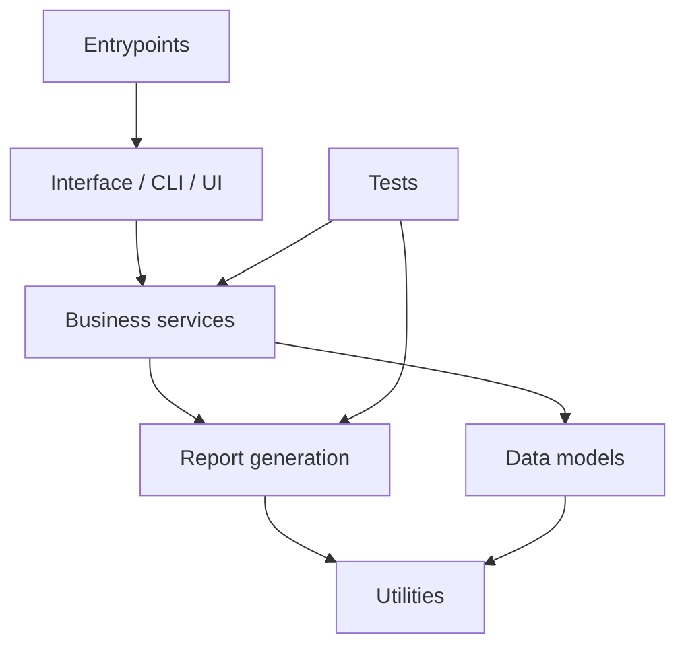

# Architecture Map

Generated: 2026-11-04 15:23:41 UTC

## Layer summary

### business_services

- `tests\unit\service\__init__.py`
- `tests\unit\service\harness.py`
- `tests\unit\service\helpers.py`
- `tests\unit\service\test_app_commands.py`
- `tests\unit\service\test_app_edges.py`
- `tests\unit\service\test_app_lifecycle.py`
- `tests\unit\service\test_app_misc.py`
- `tests\unit\service\test_app_service.py`
- `tests\unit\service\test_app_setroot.py`
- `tests\unit\service\test_commands.py`
- `tests\unit\service\test_commands_logging.py`
- `tests\unit\service\test_control.py`
- `tests\unit\service\test_control_claims.py`
- `tests\unit\service\test_integration_glue.py`
- `tests\unit\service\test_merged_service.py`
- `tests\unit\service\test_resolution.py`
- `tests\unit\service\test_router.py`
- `tests\unit\service\test_search_service.py`
- `tests\unit\service\test_status.py`
- `tests\unit\service\test_status_fields.py`
- `tests\unit\service\test_supervisor.py`

### configuration

- `.claude\settings.json`
- `.codex\agents\chatimport-interfaces.toml`
- `.codex\agents\chatimport-platform.toml`
- `.codex\agents\chatimport-privacy-security.toml`
- `.codex\agents\chatimport-quality-reviewer.toml`
- `.codex\agents\chatimport-repo-maintainer.toml`
- `.codex\agents\chatimport-step-planner.toml`
- `.codex\agents\chatimport-storage.toml`
- `.codex\agents\chatimport-telegram.toml`
- `.codex\config.toml`
- `.github\dependabot.yml`
- `.github\ISSUE_TEMPLATE\bug.yml`
- `.github\ISSUE_TEMPLATE\config.yml`
- `.github\ISSUE_TEMPLATE\feature.yml`
- `.github\workflows\ci.yml`
- `.github\workflows\codeql.yml`
- `.pre-commit-config.yaml`
- `.vscode\extensions.json`
- `.vscode\settings.json`
- `chats.example.toml`
- `config.example.toml`
- `data\raw\telegram\-1001800000001\chat.json`
- `data\raw\telegram\-1001800000002\chat.json`
- `data\raw\telegram\-1001800000003\chat.json`
- `data\raw\telegram\-1001800000004\chat.json`
- `pyproject.toml`

### data_models

- `src\chatimport\gui\models\__init__.py`
- `src\chatimport\gui\models\chats_model.py`
- `src\chatimport\gui\models\data_models.py`
- `src\chatimport\gui\models\feed.py`
- `src\chatimport\gui\models\log_model.py`
- `src\chatimport\gui\models\log_parser.py`
- `src\chatimport\gui\models\log_source.py`
- `src\chatimport\gui\models\log_tail.py`
- `src\chatimport\gui\models\presentation.py`
- `src\chatimport\gui\models\search_model.py`
- `src\chatimport\gui\models\search_spans.py`
- `src\chatimport\gui\models\snapshot.py`
- `src\chatimport\gui\models\ticker.py`

### documentation

- `.ai\CHANGELOG.md`
- `.ai\project\10-project-map.md`
- `.ai\project\11-commands.md`
- `.ai\project\12-domain-rules.md`
- `.ai\project\13-progress-tracking.md`
- `.ai\project\14-command-reference.md`
- `.ai\README.md`
- `.ai\universal\01-workflow.md`
- `.ai\universal\02-task-checklist.md`
- `.ai\universal\03-scope-and-code-style.md`
- `.ai\universal\04-architecture-boundaries.md`
- `.ai\universal\05-security-and-secrets.md`
- `.ai\universal\07-multi-assistant.md`
- `.ai\universal\08-rules-evolution.md`
- `.ai\universal\09-time-and-timestamps.md`
- `.claude\agents\chatimport-interfaces.md`
- `.claude\agents\chatimport-platform.md`
- `.claude\agents\chatimport-privacy-security.md`
- `.claude\agents\chatimport-quality-reviewer.md`
- `.claude\agents\chatimport-repo-maintainer.md`
- `.claude\agents\chatimport-step-planner.md`
- `.claude\agents\chatimport-storage.md`
- `.claude\agents\chatimport-telegram.md`
- `.claude\README.md`
- `.claude\skills\ci-fix\SKILL.md`
- `.claude\skills\code-review\SKILL.md`
- `.claude\skills\format-change\SKILL.md`
- `.claude\skills\project-maintenance\SKILL.md`
- `.claude\skills\rules-evolution\SKILL.md`
- `.claude\skills\step-episode\SKILL.md`
- `.codex\README.md`
- `.codex\skills\ci-fix\SKILL.md`
- `.codex\skills\code-review\SKILL.md`
- `.codex\skills\format-change\SKILL.md`
- `.codex\skills\project-maintenance\SKILL.md`
- `.codex\skills\rules-evolution\SKILL.md`
- `.codex\skills\step-episode\SKILL.md`
- `.github\pull_request_template.md`
- `AGENTS.md`
- `CHANGELOG.md`
- ... and 12 more

### entrypoints

- `src\chatimport\__main__.py`
- `src\chatimport\app.py`

### interface

- `src\chatimport\gui\pages\__init__.py`
- `src\chatimport\gui\pages\chats.py`
- `src\chatimport\gui\pages\chats_actions.py`
- `src\chatimport\gui\pages\chats_delegate.py`
- `src\chatimport\gui\pages\data.py`
- `src\chatimport\gui\pages\data_cleanup.py`
- `src\chatimport\gui\pages\data_common.py`
- `src\chatimport\gui\pages\data_export.py`
- `src\chatimport\gui\pages\data_folder.py`
- `src\chatimport\gui\pages\data_folder_dialog.py`
- `src\chatimport\gui\pages\data_integrity.py`
- `src\chatimport\gui\pages\data_merged.py`
- `src\chatimport\gui\pages\data_section.py`
- `src\chatimport\gui\pages\data_storage.py`
- `src\chatimport\gui\pages\library_dialog.py`
- `src\chatimport\gui\pages\log.py`
- `src\chatimport\gui\pages\log_delegate.py`
- `src\chatimport\gui\pages\log_widgets.py`
- `src\chatimport\gui\pages\overview.py`
- `src\chatimport\gui\pages\overview_feed.py`
- `src\chatimport\gui\pages\paint.py`
- `src\chatimport\gui\pages\placeholder.py`
- `src\chatimport\gui\pages\search.py`
- `src\chatimport\gui\pages\search_actions.py`
- `src\chatimport\gui\pages\search_context.py`
- `src\chatimport\gui\pages\search_delegate.py`
- `src\chatimport\gui\pages\search_filters.py`
- `src\chatimport\gui\pages\search_parts.py`
- `src\chatimport\gui\pages\search_worker.py`
- `src\chatimport\gui\pages\settings.py`
- `src\chatimport\gui\pages\settings_appearance.py`
- `src\chatimport\gui\pages\settings_config.py`
- `src\chatimport\gui\pages\settings_form.py`
- `src\chatimport\gui\pages\settings_support.py`
- `src\chatimport\gui\pages\settings_system.py`
- `src\chatimport\gui\pages\settings_telegram.py`
- `src\chatimport\gui\pages\support.py`

### other

- `.coverage`
- `.editorconfig`
- `.env`
- `.gitattributes`
- `.github\CODEOWNERS`
- `.gitignore`
- `.python-version`
- `data\chatradar.db`
- `data\chatradar.db-shm`
- `data\chatradar.db-wal`
- `data\raw\telegram\-1001800000001\20261019T223033847150Z-000000.jsonl`
- `data\raw\telegram\-1001800000001\20261019T223151138816Z-000000.jsonl`
- `data\raw\telegram\-1001800000001\20261019T223250574045Z-000000.jsonl`
- `data\raw\telegram\-1001800000001\20261021T130817945548Z-000000.jsonl`
- `data\raw\telegram\-1001800000002\20261019T223036883309Z-000000.jsonl`
- `data\raw\telegram\-1001800000002\20261019T223153322829Z-000000.jsonl`
- `data\raw\telegram\-1001800000002\20261019T223252651019Z-000000.jsonl`
- `data\raw\telegram\-1001800000002\20261021T130819551506Z-000000.jsonl`
- `data\raw\telegram\-1001800000003\20261019T223039380275Z-000000.jsonl`
- `data\raw\telegram\-1001800000003\20261019T223155382312Z-000000.jsonl`
- `data\raw\telegram\-1001800000003\20261019T223254644342Z-000000.jsonl`
- `data\raw\telegram\-1001800000003\20261021T130820943775Z-000000.jsonl`
- `data\raw\telegram\-1001800000004\20261019T223041974062Z-000000.jsonl`
- `data\raw\telegram\-1001800000004\20261019T223157517096Z-000000.jsonl`
- `data\raw\telegram\-1001800000004\20261019T223256639657Z-000000.jsonl`
- `data\raw\telegram\-1001800000004\20261021T130824068342Z-000000.jsonl`
- `design\icon-source.jpg`
- `justfile`
- `LICENSE`
- `scripts\__init__.py`
- `scripts\check_language.py`
- `scripts\doctor.py`
- `scripts\sync_agents.py`
- `src\chatimport\__init__.py`
- `src\chatimport\assets.py`
- `src\chatimport\assets\icon.ico`
- `src\chatimport\assets\icon.png`
- `src\chatimport\autostart.py`
- `src\chatimport\cli.py`
- `src\chatimport\cli_chats.py`
- ... and 128 more

### tests

- `.ai\universal\06-quality-and-testing.md`
- `tests\__init__.py`
- `tests\conftest.py`
- `tests\fakes.py`
- `tests\integration\__init__.py`
- `tests\integration\test_end_to_end.py`
- `tests\unit\__init__.py`
- `tests\unit\core\__init__.py`
- `tests\unit\core\test_assets.py`
- `tests\unit\core\test_config.py`
- `tests\unit\core\test_config_edit.py`
- `tests\unit\core\test_config_edit_literals.py`
- `tests\unit\core\test_config_merged.py`
- `tests\unit\core\test_config_search.py`
- `tests\unit\core\test_config_units.py`
- `tests\unit\core\test_gaps.py`
- `tests\unit\core\test_library.py`
- `tests\unit\core\test_library_edit.py`
- `tests\unit\core\test_library_refs.py`
- `tests\unit\core\test_logging_setup.py`
- `tests\unit\core\test_paths.py`
- `tests\unit\core\test_paths_cloud.py`
- `tests\unit\core\test_records.py`
- `tests\unit\core\test_records_lines.py`
- `tests\unit\core\test_refs.py`
- `tests\unit\core\test_runtime_ports.py`
- `tests\unit\core\test_runtime_slots.py`
- `tests\unit\core\test_textnorm.py`
- `tests\unit\core\test_toml_edit.py`
- `tests\unit\gui\__init__.py`
- `tests\unit\gui\conftest.py`
- `tests\unit\gui\logic\__init__.py`
- `tests\unit\gui\logic\spy.py`
- `tests\unit\gui\logic\test_chats_model.py`
- `tests\unit\gui\logic\test_data_models.py`
- `tests\unit\gui\logic\test_format.py`
- `tests\unit\gui\logic\test_log_model.py`
- `tests\unit\gui\logic\test_log_parser.py`
- `tests\unit\gui\logic\test_log_tail.py`
- `tests\unit\gui\logic\test_settings_zoom.py`
- ... and 139 more

## Suggested dependency direction

## Review notes

- Keep UI modules thin; long-running work should stay in services.
- Report-generation modules should not depend on a GUI toolkit.
- Utility modules should stay dependency-light and deterministic.
